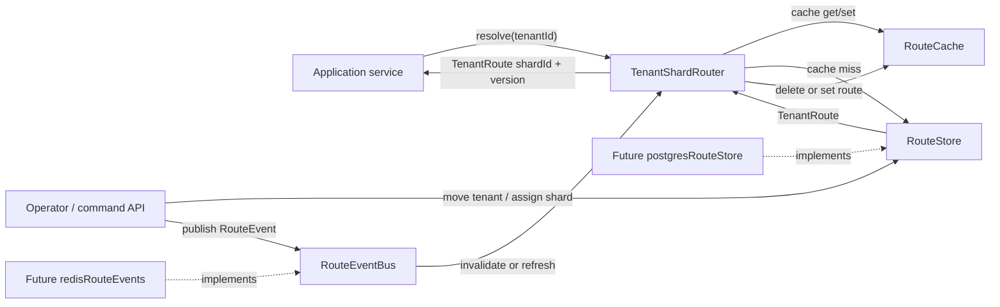

# tenant-router

Framework-neutral core API for resolving `tenantId -> shardId` routes.

The core package does not require Redis or Postgres. Instead, it defines the contracts they should implement:

- `RouteStore`: source of truth for tenant routes
- `RouteEventBus`: route-change events and cache invalidation
- `RouteCache`: local low-latency route cache

## Architecture



This is the first complete library slice: the core router owns lookup flow, cache behavior, event-driven invalidation, and the contracts official Redis/Postgres adapters will implement later.

## Core Usage

```ts
import {
  createMemoryRouteEvents,
  createMemoryRouteStore,
  createTenantRouter
} from "tenant-router";

const routeStore = createMemoryRouteStore({
  routes: [
    {
      tenantId: "acme",
      shardId: "shard-a",
      routeVersion: 1,
      tier: "pro",
      reason: "initial assignment"
    }
  ]
});

const events = createMemoryRouteEvents();
const router = createTenantRouter({
  routeStore,
  events,
  cache: { ttlMs: 30_000 }
});

const route = await router.resolve("acme");

console.log(route.shardId); // "shard-a"
```

## Route Changes

The router caches route lookups locally. When a route changes, publish an event to invalidate or refresh that cache:

```ts
routeStore.setTenantRoute({
  tenantId: "acme",
  shardId: "shard-b",
  routeVersion: 2,
  tier: "pro",
  reason: "moved away from a noisy shard"
});

await events.publish({
  type: "tenant.moved",
  tenantId: "acme",
  shardId: "shard-b",
  routeVersion: 2
});
```

## Core API

- `createTenantRouter(config)` creates a shard route resolver.
- `router.resolve(tenantId)` returns the active `TenantRoute` or throws `TenantRouteNotFoundError`.
- `router.getRoute(tenantId)` returns the active route or `null`.
- `router.explain(tenantId)` reports whether the route came from cache or store.
- `router.invalidate(tenantId)` manually clears one cached route.
- `router.close()` unsubscribes from route events.

Official adapters should implement the core interfaces:

- `postgresRouteStore(...)` should implement `RouteStore`.
- `redisRouteEvents(...)` should implement `RouteEventBus`.

## Tenant Request Matching

The package also includes a small matcher for request-like input. This is useful at API boundaries where a tenant id is inferred from a host, path, or header before resolving the tenant route.

```ts
import { createTenantMatcher } from "tenant-router";

const matcher = createTenantMatcher({
  baseDomain: "example.com",
  fallbackTenantId: "public",
  tenants: [
    { id: "public", domains: ["example.com"] },
    {
      id: "acme",
      domains: ["acme.example.com"],
      pathPrefixes: ["/acme"],
      headers: { "x-tenant-id": "acme" }
    }
  ]
});

const match = matcher.resolve({
  host: "acme.example.com",
  path: "/dashboard"
});

if (match.tenantId) {
  const route = await router.resolve(match.tenantId);
}
```

Matcher rules are evaluated in this order:

1. Header values
2. Host/domain rules
3. Path prefixes
4. Fallback tenant
