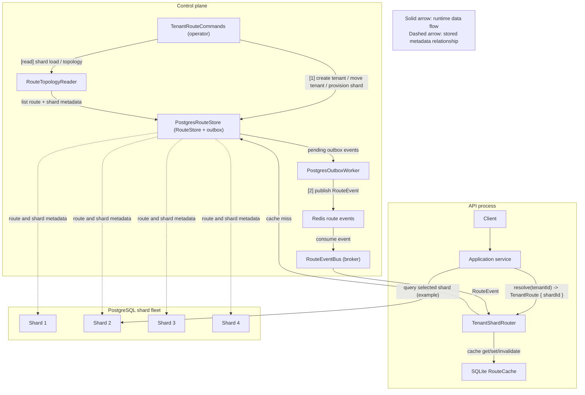

# tenant-router

Framework-neutral core API for resolving `tenantId -> shardId` routes.

The core package defines the contracts used by its first-class stack:

- `RouteStore`: source of truth for tenant routes
- `RouteEventBus`: route-change events and cache invalidation
- `RouteCache`: local low-latency route cache

The supported production shape is SQLite for the local cache, Redis for route events, and PostgreSQL for the route source of truth. The in-memory adapters remain useful for tests and single-process development.

See [the database schema reference](docs/database.md) for every persisted SQLite cache field and ready-to-run inspection queries.

## Architecture



This is the first complete library slice: the core router owns lookup flow, cache behavior, event-driven invalidation, and the contracts for its SQLite, Redis, and PostgreSQL adapters.

## Core Usage

```ts
import {
  createMemoryRouteEvents,
  createMemoryRouteStore,
  createTenantRouter
} from "tenant-router";

const routeStore = createMemoryRouteStore({
  routes: [
    {
      tenantId: "acme",
      shardId: "shard-a",
      routeVersion: 1,
      tier: "pro",
      reason: "initial assignment"
    }
  ]
});

const events = createMemoryRouteEvents();
const router = createTenantRouter({
  routeStore,
  events,
  cache: { ttlMs: 30_000 }
});

const route = await router.resolve("acme");

console.log(route.shardId); // "shard-a"
```

## Route Changes

The router caches route lookups locally. When a route changes, publish an event to invalidate or refresh that cache:

```ts
routeStore.setTenantRoute({
  tenantId: "acme",
  shardId: "shard-b",
  routeVersion: 2,
  tier: "pro",
  reason: "moved away from a noisy shard"
});

await events.publish({
  type: "tenant.moved",
  tenantId: "acme",
  shardId: "shard-b",
  routeVersion: 2
});
```

Route versions are monotonic per tenant. An API process serializes event handling and ignores an older event that arrives after a newer route has been observed, so an out-of-order Redis event cannot downgrade or delete a newer cache entry.

## Core API

- `createTenantRouter(config)` creates a shard route resolver.
- `router.resolve(tenantId)` returns the active `TenantRoute` or throws `TenantRouteNotFoundError`.
- `router.getRoute(tenantId)` returns the active route or `null`.
- `router.explain(tenantId)` reports whether the route came from cache or store.
- `router.invalidate(tenantId)` manually clears one cached route.
- `router.close()` unsubscribes from route events.

## Operator Queries

`RouteTopologyReader` is the read-only control-plane view used by operator tooling. It combines `tenant_router_routes` with `tenant_router_shards` and does not change routing.

```ts
import { createRouteTopologyReader } from "tenant-router";

const topologyReader = createRouteTopologyReader({
  routeStore,
  shardRegistry: routeStore
});

const shardLoad = await topologyReader.getShardLoad("shard-a");
const snapshot = await topologyReader.getTopologySnapshot();

console.log(shardLoad?.tenantCount, shardLoad?.loadScore);
console.log(snapshot.shards, snapshot.unassignedRoutes);
```

`tenantCount` counts current tenant-to-shard mappings. `loadScore` is the persisted operator metric from the shard definition; it is not calculated automatically and does not override `TenantRoute.shardId`.

## Route Commands

`TenantRouteCommands` is the control-plane API. It writes a route first, then publishes an event that refreshes each subscribed router cache.

```ts
import { createTenantRouteCommands } from "tenant-router";

const commands = createTenantRouteCommands({
  routeRegistry,
  shardRegistry,
  events
});

await commands.provisionShard({ id: "shard-a", region: "ap-northeast-1" });
await commands.createTenant({
  tenantId: "acme",
  shardId: "shard-a",
  tier: "pro"
});
await commands.moveTenantToShard({
  tenantId: "acme",
  shardId: "shard-b",
  reason: "rebalance"
});
```

Commands also provide `assignTenantToShard`, `changeTenantTier`, and `disableTenant`. Tenant route changes and shard provisioning use a PostgreSQL transaction/outbox so the metadata write and eventual Redis event publication remain recoverable.

Shard definitions may include `capacity` and `loadScore` (`0.0` to `1.0`) for operator observability. These values do not currently change routing automatically; `TenantRoute.shardId` remains the routing source.

When the shard registry supports `getShard()`, route commands reject assignments to unknown shards. Shard provisioning trims the shard id and validates that `loadScore` stays between `0.0` and `1.0`.

Official adapters should implement the core interfaces:

- `createSqliteRouteCache(...)` implements `RouteCache` and is available from `tenant-router/node`.
- `createPostgresRouteStore(...)` implements `RouteStore`, `TenantRouteRegistry`, and `ShardRegistry`, and is available from `tenant-router/postgres`.
- `createRedisRouteEvents(...)` implements `RouteEventBus` through Redis Streams and is available from `tenant-router/redis`.

```ts
import {
  createPostgresOutboxWorker,
  createPostgresRouteStore
} from "tenant-router/postgres";
import { createTenantRouteCommands } from "tenant-router";
import { createRedisRouteEvents } from "tenant-router/redis";

const routeStore = createPostgresRouteStore({
  connectionString: process.env.ROUTING_DATABASE_URL
});
const events = createRedisRouteEvents({
  url: process.env.REDIS_URL,
  streamKey: "tenant-router:route-events"
});

const commands = createTenantRouteCommands({
  routeRegistry: routeStore,
  shardRegistry: routeStore,
  events
});
```

Apply [`migrations/001_tenant_router.sql`](migrations/001_tenant_router.sql) before using the PostgreSQL adapter.

The Redis adapter writes each event to a stream and gives every API process its own cursor, so every router receives every route change. If a subscribed handler fails, the adapter calls the optional `onError` callback and continues consuming later events.

When PostgreSQL is used as the registry, tenant route changes and shard provisioning are also written to its outbox in the same transaction. Use the worker to retry events whose Redis publish did not complete:

```ts
const outboxWorker = createPostgresOutboxWorker(routeStore, events, {
  intervalMs: 5_000,
  batchSize: 100,
  onError: (error) => console.error("route outbox publish failed", error)
});
outboxWorker.start();

// During graceful shutdown:
await outboxWorker.stop();
await events.close();
await routeStore.close();
```

The PostgreSQL outbox publisher claims rows inside a transaction with `FOR UPDATE SKIP LOCKED`, so multiple worker instances can process separate batches. Delivery remains at-least-once: a crash after Redis accepts an event but before PostgreSQL marks it published can produce a duplicate, which consumers should handle through `eventId` and route-version checks.

## SQLite Cache

Use the Node-only SQLite adapter when a process should retain its local cache across restarts. It remains a cache: PostgreSQL will remain the authoritative `RouteStore`.

```ts
import { createSqliteRouteCache } from "tenant-router/node";

const cache = createSqliteRouteCache({
  path: "./tenant-routes.db",
  ttlMs: 30_000
});

const router = createTenantRouter({ routeStore, events, cache });
```

## Tenant Request Matching

The package also includes a small matcher for request-like input. This is useful at API boundaries where a tenant id is inferred from a host, path, or header before resolving the tenant route.

```ts
import { createTenantMatcher } from "tenant-router";

const matcher = createTenantMatcher({
  baseDomain: "example.com",
  fallbackTenantId: "public",
  tenants: [
    { id: "public", domains: ["example.com"] },
    {
      id: "acme",
      domains: ["acme.example.com"],
      pathPrefixes: ["/acme"],
      headers: { "x-tenant-id": "acme" }
    }
  ]
});

const match = matcher.resolve({
  host: "acme.example.com",
  path: "/dashboard"
});

if (match.tenantId) {
  const route = await router.resolve(match.tenantId);
}
```

Matcher rules are evaluated in this order:

1. Header values
2. Host/domain rules
3. Path prefixes
4. Fallback tenant
