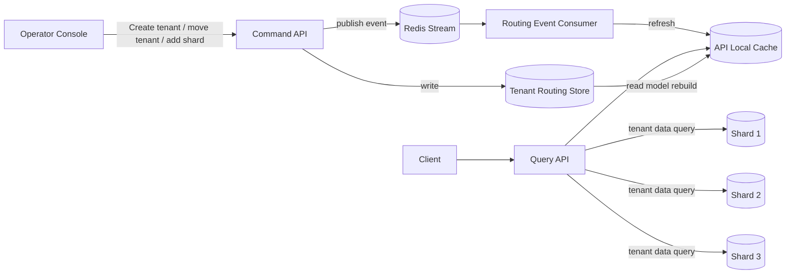

# Repo: tenant-router

## Goal

Build a real Node 24.16 + TypeScript library for multitenant shard routing with Redis-backed CQRS/event propagation.
The core product is a reusable backend library that lets services resolve which database shard a tenant/client should use, react to routing changes, and reduce noisy-neighbour impact between free, pro, and enterprise tiers.

The project is inspired by Vasilios Syrakis' article, "How to Avoid Sharding Yourself", which favors a central tenant lookup table plus cheap local routing caches over deterministic `hash(tenantId) % shardCount` routing. The UI is an example/demo app for visualizing the library in action, not the main product.

## Working Repo Name

Primary choice: `tenant-router`

Other candidates:

- `@tenant-router/core`
- `tenant-routing`
- `tenant-shard-router`
- `tenant-route-map`
- `shard-routing-kit`
- `multitenant-router`

I prefer `tenant-router` because it sounds like a real infrastructure library: short, direct, and focused on the runtime responsibility. If this becomes a scoped npm package, use `@tenant-router/core` for the library and `@tenant-router/demo` for the UI.

## Problem Statement

In a multitenant system, cheap deterministic routing such as `hash(orgId) % shardCount` works until operations need to move a noisy tenant, add shards, isolate enterprise clients, or rebalance load without downtime.

The library should answer:

- Which DB shard is this tenant connected to right now?
- Why was it routed there?
- What happens when an operator provisions a new shard?
- How do API nodes learn routing changes without blocking user traffic?
- How can paid tiers receive stronger isolation than free tenants?
- How do we visualize noisy-neighbour pressure before it becomes invisible production pain?

The demo UI should answer the same questions visually.

## Package Shape

Recommended monorepo:

```text
tenant-router/
  packages/
    core/          # framework-neutral routing library
    redis/         # Redis Streams adapter and cache invalidation
    postgres/      # Postgres metadata store and shard helpers
    fastify/       # optional Fastify plugin
    react-demo/    # UI-only demo app
  examples/
    basic-api/
    noisy-neighbour-demo/
```

Initial public API sketch:

```ts
import { createTenantRouter } from "@tenant-router/core";
import { redisRouteEvents } from "@tenant-router/redis";
import { postgresRouteStore } from "@tenant-router/postgres";

const tenantRouter = createTenantRouter({
  routeStore: postgresRouteStore({ connectionString: process.env.ROUTING_DB_URL }),
  events: redisRouteEvents({ url: process.env.REDIS_URL }),
  cache: { mode: "memory", ttlMs: 30_000 },
});

const route = await tenantRouter.resolve("pizza_hut");

const pool = shardPools.get(route.shardId);
const result = await pool.query("select * from orders where tenant_id = $1", [
  route.tenantId,
]);
```

Primary library responsibilities:

- Resolve `tenantId -> shardId`.
- Keep a local route cache fresh through Redis events.
- Expose route versions so callers can detect stale routing.
- Provide command APIs for tenant creation, tier changes, shard provisioning, and tenant moves.
- Stay framework-neutral; adapters can integrate with Fastify/Hono/Express later.

## Proposed Architecture



## CQRS Shape

Commands change routing state:

- `CreateTenant`
- `AssignTenantToShard`
- `ProvisionShard`
- `MoveTenantToShard`
- `ChangeTenantTier`
- `DisableTenant`

Queries read routing state:

- `GetTenantRoute`
- `ListTenantRoutes`
- `GetShardLoad`
- `ExplainTenantRoute`
- `GetTopologySnapshot`

Events describe routing changes:

- `TenantCreated`
- `TenantAssignedToShard`
- `ShardProvisioned`
- `TenantMoved`
- `TenantTierChanged`
- `RouteCacheInvalidated`

Redis roles:

- Redis Streams for command-side events and fan-out to API nodes.
- Redis hashes or JSON-like keys for a shared read model if needed.
- SQLite per-API route cache for restart-safe local lookups; in-memory adapters remain test fakes.
- Optional Redis pub/sub for low-latency cache invalidation, with Streams kept as the durable event log.

## Tenant Tier Model

Free tier:

- Many tenants can share the same shard.
- Routing can prioritize even distribution and cost.
- Noisy tenants can be throttled or moved into a quarantine shard.

Pro tier:

- Fewer tenants per shard.
- Higher rate limits.
- Can be moved during controlled maintenance windows.

Enterprise tier:

- Dedicated shard or dedicated shard group.
- Explicit routing policy.
- Stronger observability and manual override support.
- Future option for region pinning and custom backup policy.

## Noisy-Neighbour Strategy

The first implementation should not try to solve every database isolation problem. It should make the problem visible and controllable.

MVP controls:

- Per-tenant request rate simulation.
- Per-shard load score.
- Tenant tier limits.
- Operator action to move a tenant.
- Event-driven cache refresh so the API starts routing to the new shard.

Later controls:

- Automatic tenant move recommendation.
- Write draining before migration.
- Dual-read or dual-write migration mode.
- Background copy job and verification.
- Circuit breaker per tenant and per shard.

## Demo UI Direction

The UI is a demo and observability surface for the library. It should prove the routing behavior is understandable, but the library must remain usable without the UI.

Use a dark topology canvas with a subtle grid.

Visible nodes:

- Client or tenant nodes, colored by tier.
- API node.
- Local cache node.
- Redis routing source of truth.
- Broker/event stream.
- Shard nodes with load rings.
- Operator node or side panel.

Expected interactions:

- Select a tenant to highlight the active path: tenant -> API -> cache -> shard.
- Show the resolved route as structured data, for example `{ tenantId, tier, shardId, routeVersion }`.
- Add a tenant from the operator panel.
- Provision a new shard and watch it appear on the canvas.
- Move a tenant and animate route invalidation through Redis/broker/cache.
- Show stale vs fresh cache state during event propagation.

Visual language:

- Free tenants: cool neutral.
- Pro tenants: blue.
- Enterprise tenants: gold or green.
- Overloaded shard: red ring.
- Moving tenant: animated dashed edge.
- Stale cache: amber pulse.

## Suggested Tech Stack

Library:

- Node 24.16
- TypeScript
- Framework-neutral core package
- ioredis or node-redis for the Redis adapter
- Zod for command/query validation
- Pino for structured logs

Optional server adapters:

- Fastify plugin first
- Hono or Express adapter later

Demo UI:

- Vite + React + TypeScript
- React Flow for topology graph
- TanStack Query for API state
- CSS modules or Tailwind, depending on preference
- Lucide icons for controls

Local infra for examples:

- Docker Compose for Redis and database shards
- PostgreSQL containers as realistic shard targets
- SQLite is the first-class per-API route cache; PostgreSQL remains the routing metadata store and realistic shard target

## Data Model Draft

Tenant route:

```ts
type TenantRoute = {
  tenantId: string;
  displayName: string;
  tier: "free" | "pro" | "enterprise";
  shardId: string;
  routeVersion: number;
  status: "active" | "disabled";
  updatedAt: string;
};
```

Shard:

```ts
type Shard = {
  shardId: string;
  name: string;
  status: "provisioning" | "online" | "draining" | "offline";
  tierPolicy: "shared" | "premium" | "dedicated";
  maxTenants: number;
  loadScore: number;
};
```

Routing event:

```ts
type RoutingEvent = {
  eventId: string;
  type: string;
  routeVersion: number;
  tenantId?: string;
  shardId?: string;
  occurredAt: string;
  payload: Record<string, unknown>;
};
```

## Milestones

Status key: **done** / **partial** / **not started** / **won't do (for now)**.

### 1. Library scaffold — **partial**
- [x] Repo name `tenant-router`, Node 24.16 + TypeScript
- [x] Docker Compose: Redis, routing Postgres, shard Postgres, local API, control panel
- [x] Adapters as `src/index.ts` + `src/postgres.ts` + `src/redis.ts` + `src/node.ts` (SQLite cache)
- [ ] Monorepo `packages/core|redis|postgres|fastify` — **won't do (for now)**; single package + `apps/control-panel` is enough
- [ ] Fastify plugin package — **won't do (for now)**

### 2. Core library API — **done**
- [x] `createTenantRouter`, route resolve, route versions, cache policy
- [x] `RouteStore` / events / cache interfaces; memory fakes + tests
- [x] Commands: create, assign, move, tier, disable, provision, delete shard
- [x] Queries: topology, shard load, `explain` (cache vs store)

### 3. Routing source of truth adapters — **done**
- [x] Postgres metadata + outbox; Redis Streams fan-out
- [x] Local API command/query HTTP for demos (not a production gateway)

### 4. API local cache — **done**
- [x] SQLite (and memory) route cache; warmup; subscribe/invalidate
- [x] `explain` exposes cacheHit / source / routeVersion (control panel shows on tenant select)

### 5. Shard simulation example — **partial**
- [x] Multiple shard DBs in Compose; resolve → pool when wired
- [x] Demo `loadScore` from real `POST /tenants/:id/query` traffic (Redis shared QPS window / `DEMO_LOAD_QPS_CAP`; may exceed 1.0; never blocks). Metadata-only shards stay 0 qps / 503 on query
- [x] Demo load = interactive/real API queries (not background chatter / pg_stat)
- [x] Control panel draws one API node per live replica (`GET /instances` via Redis registry); resolve edge uses answering `instanceId`
- [ ] Automatic noisy detection / policy engine — **not started**
- [ ] Metadata-only provisioned shards have no pool until `SHARD_N_DATABASE_URL` — intentional for demo

### 6. Interactive demo UI — **partial**
- [x] React Flow topology: RouteStore, Redis, API+cache, shards, tier-colored tenants
- [x] Path flash on writes; drag MoveTenant; create/tier/disable; provision/delete shard
- [x] Noisy-neighbour stepped demo; selected tenant resolve strip (cache/store/version/pool)
- [ ] Separate cache node + stale-vs-fresh animation — **not started**
- [ ] Full event log dock — **not started**
- [ ] TanStack Query / Lucide — **won't do (for now)**; plain fetch is fine

### 7. Operational scenarios — **partial**
- [x] Free tenants on shared shard; noisy crowd + MoveTenant isolate
- [x] Provision shard + move onto it (routing metadata; optional physical DB)
- [x] Cache updates via Redis after commands (verify with resolve strip / multi-API compose)
- [ ] Enterprise "dedicated shard policy" engine — **not started** (tier is a label + manual placement)
- [ ] Real data migration (dual-read/write, copy job) — **won't do (for now)**; moves update the lookup row only

## Open Questions (resolved for this repo)

- First shards: **PostgreSQL** (routing metadata + business shard DBs); SQLite only for per-API route cache.
- CQRS shape: **metadata table + Redis stream / outbox**, not full event sourcing.
- Tenant moves (MVP): **immediate lookup update** to the new `shardId`. No business-data copy between shard DBs.
- Redis: **events/cache fan-out only**; Postgres is routing SoT.
- Demo UI: **educational ops console** (Placement Map), not a separate product.

## Current Recommendation


For the first build, keep the library boring but resilient:

- PostgreSQL for tenant routing metadata and shard databases.
- Redis Streams for routing events.
- API in-memory cache for hot route lookup.
- Framework-neutral `@tenant-router/core`.
- React Flow UI only as a topology demo.
- Manual operator-driven tenant moves before automatic rebalancing.

This keeps the library faithful to the article's main point: avoid hard-coded deterministic sharding, use a lookup table, and make routing changes operationally cheap.
